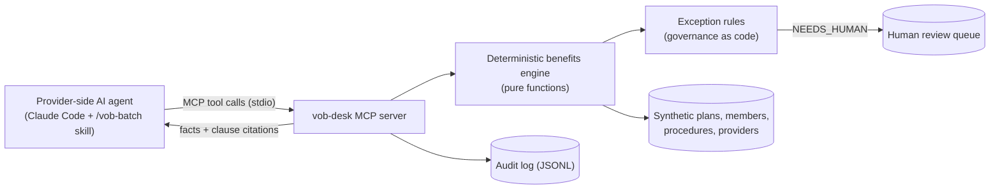

# VOB Desk

**Independent student project. Not affiliated with, endorsed by, or built for any insurer or dental benefits company. All plans, members, providers and procedure IDs are fictional.**

Author: Surya Datla

VOB Desk ("verification of benefits") is an MCP server on synthetic dental-plan data. It lets a dental office's AI agent verify benefits for a batch of patients in one call. A deterministic engine returns only the facts needed, each with a plan-clause citation. Exceptions go to a human review queue instead of being guessed, and every call is audit-logged.

## Problem

Offices can now buy AI tools that verify patients' insurance benefits for them. Some are voice agents that phone the payer; others are portal or API tools that run eligibility checks, some in batches for high volumes ([Prosper AI's 2026 guide](https://www.getprosper.ai/blog/ai-insurance-verification-tools-voice-and-portal), a vendor source). This demo looks at the other end of that conversation and asks: what does an insurer-side front door for AI callers need to be accurate, auditable and safe?

## What it does

An agent (here Claude Code with the `/vob-batch` skill) sends up to 25 patient rows per call. Each row comes back with one of three statuses:

| Status | Meaning | What the caller gets |
|---|---|---|
| `VERIFIED` | Identity matched and coverage is active on the planned date | Per procedure: covered %, frequency used and remaining, waiting-period end date, advisories, clause citations; deductible and annual maximum remaining |
| `NOT_VERIFIED` | Identity did not match, or coverage is not active | Reason codes only, no plan data |
| `NEEDS_HUMAN` | Twins with the same birth date, other coverage, or an unknown procedure | Reason codes and a review-ticket ID, no plan data |

Four MCP tools:

| Tool | Purpose |
|---|---|
| `verify_benefits_batch` | 1-25 rows (1-8 procedures each) in, facts with citations out |
| `get_plan_clause` | Verbatim text of a cited clause, for "why?" questions |
| `search_plan_docs` | Keyword retrieval over plan clauses (top 3) |
| `list_review_queue` | Open human-review tickets (no member data) |

Sample output: [`demo/sample-session.md`](demo/sample-session.md) (one real headless run) and [`demo/sample-audit.jsonl`](demo/sample-audit.jsonl).

## Architecture



| Path | Contents |
|---|---|
| `src/engine/` | Pure functions (no I/O, no clock): `verify.ts` (the engine), `rules.ts` (R01-R11, A01-A03), `search.ts`, `mask.ts`, `dates.ts`, `types.ts` |
| `src/server.ts` | MCP wiring, input schemas, audit and review-queue logs |
| `data/` | Two synthetic plans with numbered clauses, 12 procedures, 25 members, 4 providers; `EDGE_CASES.md` maps each member to the rule it exercises |

## Design decisions

- **Facts from code, not the model.** The LLM never computes coverage. Every number comes from the engine, and the agent quotes it.
- **MCP as the machine-to-machine front door.** Strict schemas, batch input, compact JSON output.
- **Data minimization.** Masked member refs, and no plan data on rows that fail identity or eligibility checks. An unknown member ID gets the same answer as a wrong birth date, so IDs cannot be probed.
- **No CDT codes.** Real systems use the ADA's CDT codes, which need a license for any product use, so the demo invents its own procedure IDs.

More detail, including every simplification and every deviation from the original spec: [`docs/decisions.md`](docs/decisions.md).

## Context engineering

1. **Tool descriptions are contracts.** Each says when to call it, what it never returns, and that numbers must be quoted from output.
2. **Just-in-time context.** The batch tool returns clause IDs only. Full clause text loads through `get_plan_clause` when someone asks "why", which keeps a 25-row result small.
3. **Skill over system prompt.** The verification procedure lives in `.claude/skills/vob-batch/SKILL.md` and loads only when `/vob-batch` is used. `CLAUDE.md` holds the build rules for working on the code: two layers for two jobs.
4. **Untrusted-input isolation.** The `notes` field is stored and logged but never interpreted. An engine test shows notes cannot change a result, and an agent eval case puts an injection in notes.
5. **Structured, minimal outputs.** Masked references, no plan data on failed checks, and a fixed disclaimer.
6. **Deterministic facts.** The model cannot hallucinate a percentage that it never computes.

## Evaluation

Full tables and the fix log: [`eval/RESULTS.md`](eval/RESULTS.md). **Small n; not a benchmark.**

| Check | Result |
|---|---|
| Engine cases (`eval/cases.jsonl`), first run | 40/40 |
| Engine cases, final | 40/40 |
| Leakage (plan data on non-verified rows; must be 0) | 0 of 10 non-verified rows |
| Citation coverage (verified procedures with a valid clause ID) | 35/35 |
| Stdio integration test (`test/server.test.ts`) | 8/8 steps |
| Agent eval (`eval/agent-cases.jsonl`, 6 headless Claude Code runs) | 6/6 on automatic checks. A manual read found 1 wording error and 1 statement beyond tool output (see `eval/RESULTS.md`) |

The engine passed all 40 cases on its first run. The cases were written from the data and plan terms before the engine code, so the honest first-run number is 40/40. To check that the cases are not vacuous, a one-time mutation check changed plan terms in memory (for example Plan B basic coinsurance 70% to 75%). Each change broke the cases that depend on it (details in `eval/RESULTS.md`).

## Limitations

- Synthetic data only; the plan terms are invented.
- No voice channel; machine-to-machine over MCP only.
- No X12 270/271 eligibility transactions, the standard that real payers use.
- No real authentication: provider IDs are trusted strings.
- stdio only, not a hosted server.
- Not security-reviewed. It uses least-privilege patterns, but it is a demo.
- It makes no coverage determinations. Benefit information is not a guarantee of payment.

## Built with Claude Code

The author chose the problem and set the requirements and design rules. The spec ([`docs/spec.md`](docs/spec.md)) was drafted with Claude, and Claude Code (Anthropic's coding agent) wrote the TypeScript, the synthetic data and the tests from it in one session. Every number the demo reports comes from the deterministic engine and is checked by the test suite.

Harness features used:

- **`CLAUDE.md`**: project rules (synthetic data only, the engine stays pure, the LLM never computes coverage).
- **A custom skill**: `.claude/skills/vob-batch/SKILL.md`, invoked as `/vob-batch`.
- **`.mcp.json`**: registers the `vob-desk` server for the project.
- **The context7 MCP server**: current MCP TypeScript SDK v2 documentation while building.
- **Headless `claude -p`**: the sample run and the agent eval. Both used `--strict-mcp-config`, an `--allowedTools` list limited to the four vob-desk tools plus `Read`, and `--max-turns`. The eval also used `--json-schema` for scoring.

## Run it

Requires Node 24. No API keys, paid services or network calls at runtime.

```bash
npm install
npm test                 # 40 engine cases, data checks, stdio integration test
npm start                # optional: the MCP server on stdio (Claude Code starts it itself)
```

Then open Claude Code in this folder, approve the project's `vob-desk` MCP server when asked, and run:

```text
/vob-batch demo/sample-batch.csv
```

Ask a follow-up such as "Why is the crown on R-004 at 0%?" to see `get_plan_clause` at work. The optional agent eval is `npm run eval:agent`; it runs `claude -p` once per case and uses Claude Code usage.

## Next steps if this were real

- Provider authentication, with identity propagated to every call.
- Rate limits.
- A hosted MCP endpoint (Streamable HTTP).
- An X12 270/271 integration.
- Monitoring and alerting on exception rates.
- Red-team tests for prompt injection.
- Review through a governance process before any real data.

## License

MIT. See [`LICENSE`](LICENSE).
